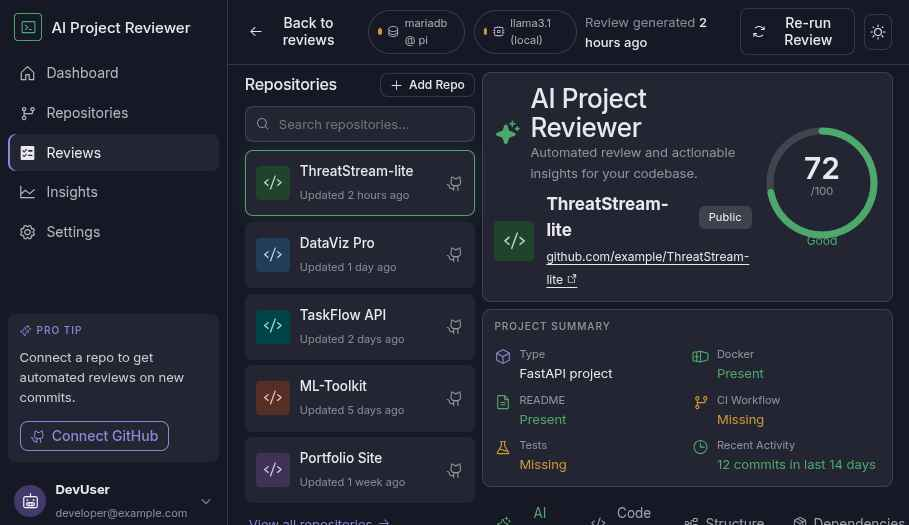
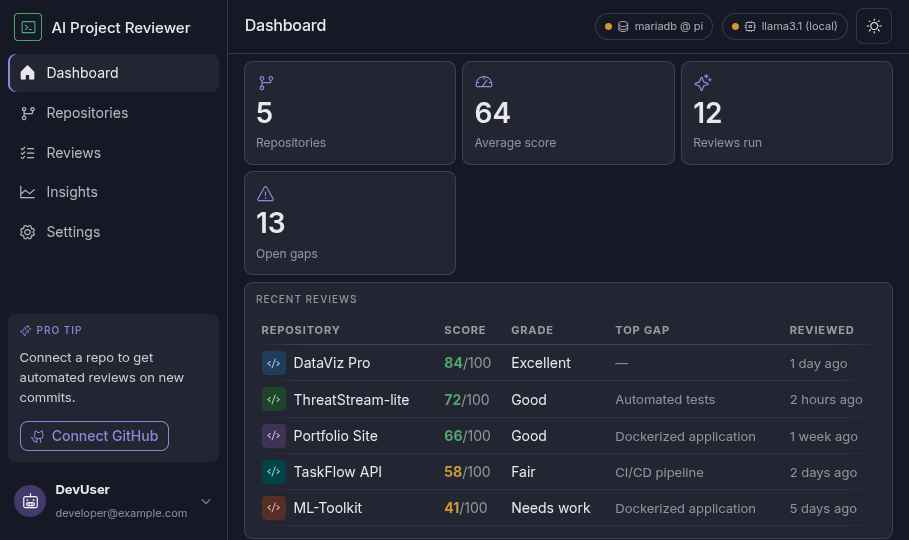
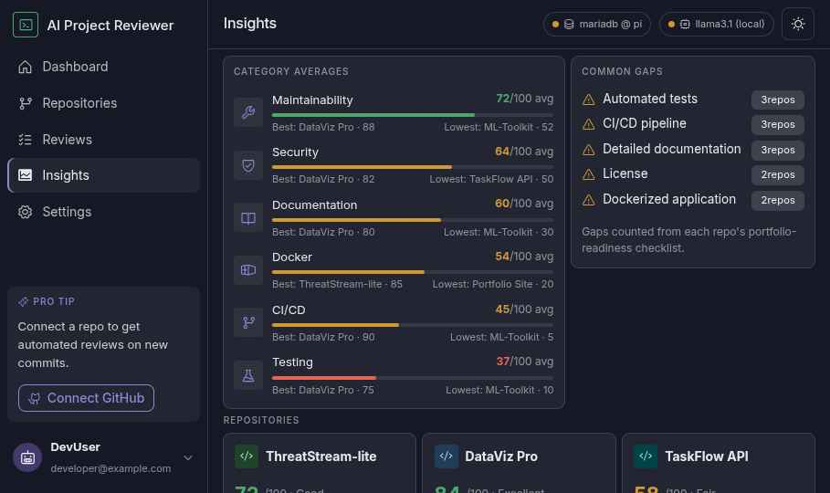
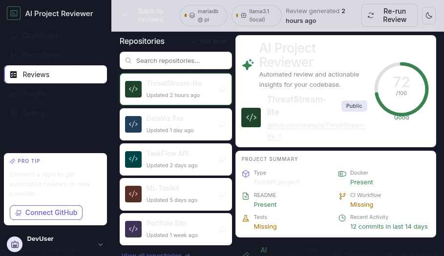

# AI Project Reviewer

AI Project Reviewer is a self-hosted dashboard for evaluating software repositories and turning review data into practical, portfolio-focused feedback. It presents an overall score, category scores, strengths, improvement areas, recommended next steps, dependency and security findings, and cross-repository insights.

The project is designed to run on a local network with MariaDB for persistence and a local inference server (Ollama or LM Studio) for AI summaries. No hosted application or cloud AI service is required.



> [!IMPORTANT]
> The project is under active development. The frontend, MariaDB API, repository registration, durable review jobs, deterministic analysis, bounded Ollama narrative pipeline, repository-management UI, optional single-user authentication, and Docker/Raspberry Pi packaging are implemented. The Docker packaging has been unit-tested and validated with `docker compose config`, but has not had a live `docker compose up --build` run in this repository's own development sandbox — see [Docker / Raspberry Pi Deployment](#docker--raspberry-pi-deployment).

## What Works Today

- Portfolio dashboard with repository counts, average score, open gaps, recent reviews, and weakest categories
- Detailed repository reviews with AI Review, Code Quality, Structure, Dependencies, and Security tabs
- Portfolio-readiness checklists and recommended next steps
- Cross-repository category averages and common-gap insights
- Responsive dark and light themes with a saved theme preference
- Fastify REST API backed by MariaDB
- Idempotent schema migration and repeatable sample-data seeding
- Public GitHub repository registration with durable, deduplicated review jobs
- Sequential restart-safe worker with bounded clone/cache updates and deterministic persisted reviews
- Safe static inventory, dependency freshness, secret-risk, Git activity, and weighted scoring checks without executing repository code
- Repositories screen to connect a public GitHub URL, watch queued/running/reviewed status live, and run or re-run reviews
- Opt-in demo mode (`VITE_DEMO_MODE=true`) for showing embedded sample reviews without a live API; otherwise an unreachable API is reported honestly, never silently masked
- Optional single-user token authentication (`AUTH_TOKEN`), gating the API behind an HttpOnly session cookie while staying LAN-open by default
- Optional API-owned local-model narratives (Ollama or LM Studio) with strict validation, one malformed-output retry, and deterministic fallback
- Settings screen to choose the inference provider and model, saved in MariaDB and applied without an API restart (see [Local Inference](#local-inference))
- Docker Compose packaging that serves the API and built frontend from one origin, with MariaDB and an optional bundled-Ollama profile, for Raspberry Pi deployment

## Screenshots

| Dashboard | Insights |
| --- | --- |
|  |  |

| Review: dark theme | Review: light theme |
| --- | --- |
|  |  |

## Architecture

```text
React + Vite frontend
    |-- GET /api/repos -----------------> Fastify API -----> MariaDB
    |-- GET /api/repos/:id                  |
    |-- POST /api/repos                     +-- schema migration
    |-- POST /api/repos/:id/rerun           +-- durable sequential worker
    |                                           |-- bounded public Git clone/cache
    |                                           |-- safe deterministic analysis
    |                                           |-- registry freshness lookups
    |                                           +-- bounded narrative -----> Ollama or LM Studio (optional, local)

If the API cannot be reached, the frontend shows an honest error state (or embedded sample reviews, only when VITE_DEMO_MODE=true).
If local inference is disabled or unreachable, the worker persists the complete deterministic template narrative.
```

### Technology Stack

| Area | Technology |
| --- | --- |
| Frontend | React, Vite, TypeScript, React Router, plain CSS |
| API | Node.js, Fastify, TypeScript |
| Database | MariaDB through `mysql2/promise` |
| Local AI | API-owned Ollama or LM Studio client with validated JSON fallback |
| Icons | Phosphor Icons |

## Quick Start

### Standalone Frontend

The fastest way to explore the interface is to run the frontend by itself in demo mode, which shows the five embedded sample reviews instead of calling the API. Without `VITE_DEMO_MODE=true`, an unreachable API is reported as an error rather than masked with sample data.

```bash
git clone https://github.com/jimjamscott22/AI-Project-Reviewer.git
cd AI-Project-Reviewer/frontend
npm install
VITE_DEMO_MODE=true npm run dev
```

On Windows PowerShell, set the variable first: `$env:VITE_DEMO_MODE = 'true'; npm run dev`. Open <http://localhost:5173>.

### Frontend with MariaDB

You will need:

- Node.js `20.19+` or `22.12+`
- npm
- A reachable MariaDB server
- MariaDB credentials allowed to create the configured database and tables

Start the API first:

```bash
cd api
cp .env.example .env
npm install
```

Edit `api/.env` for your MariaDB instance, then initialize and start the service:

```bash
npm run migrate
npm run seed
npm run dev
```

In another terminal, start the frontend:

```bash
cd frontend
npm install
npm run dev
```

The development frontend is already configured to use `http://localhost:8080`. Open <http://localhost:5173>; the MariaDB status chip turns green when the API returns review data.

`npm run migrate` creates the configured database and applies the schema idempotently. `npm run seed` replaces only the bundled sample repositories and their related reviews, so it is safe to rerun during development.

## Docker / Raspberry Pi Deployment

The app ships as a single Docker Compose stack: one image serves the API and the built frontend from the same origin — Fastify answers `/api/*` itself and serves the SPA (with a client-side-route fallback) for everything else — alongside a MariaDB container. Ollama can run directly on the host, or be bundled as a third container.

> [!NOTE]
> This packaging (`Dockerfile`, `docker-compose.yml`, the static-serving/SPA-fallback code, and the migration entrypoint) was authored and unit-tested in this repository — see `api/test/static.test.ts` — but a live `docker compose up --build` has not been run here: this development sandbox's container registry access is blocked by policy. Run `scripts/docker-smoke-test.sh` on a machine with normal Docker registry access (a dev machine or the Pi itself) to validate a real build before relying on this in production; it checks non-root execution, MariaDB/API health ordering, data persistence across a restart, auth enabled/disabled, and an SPA deep link.

### Prerequisites (Raspberry Pi, 64-bit / ARM64)

- Raspberry Pi OS (64-bit) or another ARM64 Linux distribution
- Docker Engine and the Compose plugin (`docker compose version`)
- At least 2 GB free RAM for MariaDB + API (4 GB+ if you bundle Ollama)
- Optionally, Ollama installed directly on the Pi, or run via the bundled `with-ollama` Compose profile

The Node and MariaDB images used by `Dockerfile` and `docker-compose.yml` all publish `linux/arm64` variants, so `docker compose build` on a Pi produces a native image with no cross-compilation.

### First boot

```bash
git clone https://github.com/jimjamscott22/AI-Project-Reviewer.git
cd AI-Project-Reviewer
cp .env.example .env
```

Edit `.env`: set real values for `DB_ROOT_PASSWORD` and `DB_PASSWORD`, and leave `AUTH_TOKEN` empty for LAN-open access or set it now (see [Token setup](#token-setup)). Then build and start:

```bash
docker compose up -d --build
```

The `api` container applies the database schema automatically on every start (idempotently — see `api/docker-entrypoint.sh`); it never runs the sample-data seed in production. Once `docker compose ps` shows `mariadb` and `api` as `healthy`, open `http://<pi-hostname-or-ip>:8080`.

To bundle Ollama instead of pointing at a host install:

```bash
docker compose --profile with-ollama up -d --build
```

then set `OLLAMA_BASE_URL=http://ollama:11434` in `.env` and restart just the API: `docker compose up -d api`.

### Pull a model (bundled Ollama)

```bash
docker compose exec ollama ollama pull llama3.1
```

Use whatever model `OLLAMA_MODEL` is set to in `.env`. Until it's pulled, review narratives fall back to the deterministic template text rather than failing.

### Token setup

Set `AUTH_TOKEN` in `.env` to a long random value (e.g. `openssl rand -hex 32`), then restart the API:

```bash
docker compose up -d api
```

Every route except `/api/health` and `/api/session*` now requires signing in with that token from the app's login screen. Leave `AUTH_TOKEN` empty to keep the app open to anyone on the LAN.

### Backups

MariaDB data lives in the named `db_data` volume; the repository work cache lives in `review_work`.

```bash
docker compose exec mariadb sh -c 'exec mariadb-dump -u root -p"$MARIADB_ROOT_PASSWORD" --all-databases' > backup-$(date +%F).sql
docker run --rm -v ai-project-reviewer_review_work:/data -v "$PWD":/backup alpine tar czf /backup/review-work-$(date +%F).tar.gz -C /data .
```

### Upgrades

```bash
git pull
docker compose up -d --build
```

The migration runner applies any new schema changes automatically on that restart.

### Logs

```bash
docker compose logs -f api
docker compose logs -f mariadb
```

### Health checks

```bash
docker compose ps                        # healthy/unhealthy per service
curl http://localhost:8080/api/health
```

### Rollback

```bash
git checkout <previous-tag-or-commit>
docker compose up -d --build
```

Migrations are additive and idempotent, so rolling the code back does not roll back the schema — only roll back across a version boundary that never removed a column or table the restored code still expects.

## Configuration

### API

Copy [`api/.env.example`](api/.env.example) to `api/.env` and configure:

| Variable | Default | Purpose |
| --- | --- | --- |
| `PORT` | `8080` | API listen port |
| `CORS_ORIGIN` | `http://localhost:5173` | Allowed frontend origin (credentialed, exact match) |
| `NODE_ENV` | `development` | Set to `production` to mark the session cookie `Secure` |
| `STATIC_DIR` | empty | Absolute path to a built frontend (`frontend/dist`) to serve from the same origin as the API, with an SPA fallback for client-side routes. Empty in local dev, where Vite serves the frontend separately. Set by the Docker image automatically |
| `AUTH_TOKEN` | empty | Optional single-user access token. Empty keeps the API LAN-open (no login); setting it requires a matching token before any route other than `/api/health` and `/api/session*` is reachable |
| `AUTH_SESSION_TTL_MS` | `43200000` | Sliding session lifetime (12h) once signed in |
| `DB_HOST` | `localhost` | MariaDB host |
| `DB_PORT` | `3306` | MariaDB port |
| `DB_USER` | `apr` | MariaDB user |
| `DB_PASSWORD` | `apr` | MariaDB password |
| `DB_NAME` | `apr` | Database created and used by the API |
| `REPO_WORK_ROOT` | `.review-work` | Validated child directory for persistent public-repository caches |
| `REPO_CLONE_TIMEOUT_MS` | `120000` | Git clone/fetch/reset command timeout |
| `REPO_COMMAND_OUTPUT_BYTES` | `65536` | Git/tool output cap |
| `ANALYSIS_TIMEOUT_MS` | `120000` | Filesystem-analysis wall-clock limit |
| `ANALYSIS_MAX_FILES` | `5000` | Maximum analyzable text files |
| `ANALYSIS_MAX_TOTAL_BYTES` | `26214400` | Maximum aggregate text bytes |
| `ANALYSIS_MAX_FILE_BYTES` | `262144` | Per-file text limit; larger files are skipped |
| `REGISTRY_TIMEOUT_MS` | `3000` | Timeout for each npm/PyPI lookup |
| `REGISTRY_MAX_PACKAGES` | `30` | Maximum dependency lookups per review |
| `WORKER_POLL_MS` | `1000` | Durable queue poll interval |
| `GITLEAKS_PATH` | empty | Optional explicitly pinned gitleaks binary path |
| `OLLAMA_BASE_URL` | `http://localhost:11434` | API-side Ollama base URL; empty disables Ollama calls |
| `OLLAMA_MODEL` | `llama3.1` | Ollama model used by the worker |
| `OLLAMA_TIMEOUT_MS` | `45000` | Narrative request timeout |
| `OLLAMA_HEALTH_TIMEOUT_MS` | `1500` | Health-probe timeout |
| `OLLAMA_MAX_PROMPT_BYTES` | `12288` | Maximum deterministic-evidence prompt size |
| `OLLAMA_MAX_RESPONSE_BYTES` | `65536` | Maximum model response size |
| `LMSTUDIO_BASE_URL` | `http://localhost:1234` | API-side LM Studio server root (no `/v1`) |
| `LMSTUDIO_MODEL` | empty | LM Studio model used by the worker |
| `LMSTUDIO_API_TOKEN` | empty | Optional LM Studio bearer token; never returned to the browser |
| `LMSTUDIO_TIMEOUT_MS` | `120000` | LM Studio narrative request timeout |

Provider, URL and model values saved on the Settings screen are stored in MariaDB and override these environment defaults. See [Local Inference](#local-inference).

### Frontend

Vite reads these variables at startup:

| Variable | Development value | Purpose |
| --- | --- | --- |
| `VITE_API_BASE` | `http://localhost:8080` | Fastify API base URL |
| `VITE_DEMO_MODE` | unset | Set to `true` to fall back to embedded sample data when the API is unreachable; otherwise an unreachable API shows an honest error |

The checked-in [`frontend/.env.development`](frontend/.env.development) sets the local API URL. The browser never receives an Ollama base URL or contacts port 11434 directly. All requests are sent with `credentials: 'include'` so the optional session cookie (see `AUTH_TOKEN` above) is carried when set.

## Local Inference

Open **Settings → Local inference** to select **Ollama**, **LM Studio**, or **Disabled** (deterministic template summaries). For LM Studio, enter its server URL, choose a downloaded text-generation model, and click **Save settings**. **Refresh models** reloads the list without changing saved settings. Embedding models are excluded. The picker does not download or load models, so unloaded models need just-in-time loading enabled in LM Studio or must be loaded there manually.

Selections are stored in MariaDB and override the environment defaults without an API restart. Each review snapshots the settings when its worker starts, so an active review keeps its selection. Each provider retains its own URL and model.

The URL must be reachable **from the API server**, not just your browser. For an API on a Raspberry Pi and LM Studio on a desktop, use the desktop's LAN address and enable LM Studio's network server access; `localhost:1234` means the API's own machine. Enter the server root URL without `/v1`. Model discovery uses LM Studio's `/api/v1/models` endpoint, so use a version that supports it.

If LM Studio requires authentication, set `LMSTUDIO_API_TOKEN` in the API environment and restart the API. Existing `OLLAMA_*` defaults remain supported, and existing installations keep using Ollama until the provider is changed in Settings.

Connection or authentication failures appear in Settings, and saved models are retained even when unavailable. If narrative generation fails, the worker falls back to the validated deterministic template. Scores always come from repository analysis, never from the model.

## API

The implemented API surface is:

| Method | Endpoint | Description |
| --- | --- | --- |
| `GET` | `/api/health` | Check database, worker, and non-secret inference-provider capability state |
| `GET` | `/api/settings` | Read the API-owned inference provider, URLs and models |
| `PUT` | `/api/settings` | Validate and persist inference settings |
| `POST` | `/api/settings/models` | List downloaded text-generation models from an LM Studio server URL |
| `GET` | `/api/repos` | List repositories with their latest reviews |
| `GET` | `/api/repos/:id` | Get one repository and its latest review |
| `GET` | `/api/repositories` | List every registered repository, including unreviewed entries and latest job state |
| `POST` | `/api/repos` | Register repository metadata |
| `POST` | `/api/repos/:id/rerun` | Create or reuse the repository's active durable review job |
| `GET` | `/api/jobs/:id` | Poll durable review-job state |
| `GET` | `/api/session` | Report whether a token is required and whether the caller is currently signed in |
| `POST` | `/api/session/login` | Exchange `AUTH_TOKEN` for an HttpOnly session cookie (rate-limited; 404 when auth is disabled) |
| `POST` | `/api/session/logout` | Clear the caller's session |

When `AUTH_TOKEN` is unset the API stays LAN-open and every route above is reachable without a session. When it's set, `/api/health` and the `/api/session*` routes stay reachable, but every other route requires the session cookie issued by a successful login.

Example:

```bash
curl http://localhost:8080/api/health
curl http://localhost:8080/api/repos
```

Register a public GitHub repository:

```bash
curl -X POST http://localhost:8080/api/repos \
  -H 'content-type: application/json' \
  -d '{"url":"https://github.com/example/project"}'
```

Registration canonicalizes public `https://github.com/owner/repository` URLs. Private repositories, credentials, query strings, and non-GitHub hosts are rejected. While the API process is running, a rerun request is claimed by its single sequential worker and persisted as a complete deterministic review. The worker never runs repository scripts or loads repository configuration as code.

## Development Commands

Run commands from the relevant workspace directory.

| Workspace | Command | Purpose |
| --- | --- | --- |
| `frontend/` | `npm run dev` | Start the Vite development server |
| `frontend/` | `npm run build` | Type-check and create a production build |
| `frontend/` | `npm run lint` | Lint frontend source files |
| `frontend/` | `npm test` | Run the Vitest component and unit tests |
| `frontend/` | `npm run preview` | Preview the production build |
| `api/` | `npm run dev` | Start the API with file watching |
| `api/` | `npm run build` | Compile TypeScript into `api/dist/` |
| `api/` | `npm start` | Run the compiled API |
| `api/` | `npm run typecheck` | Type-check source and tests without emitting files |
| `api/` | `npm run lint` | Lint API source files |
| `api/` | `npm test` | Run the unit and route tests (no database or Ollama needed) |
| `api/` | `npm run test:integration`, `test:worker-integration`, `test:ollama-integration`, `test:inference-integration` | Integration suites that need a live MariaDB and/or a local inference server |
| `api/` | `npm run migrate` | Create the database and apply the schema |
| `api/` | `npm run seed` | Load the bundled sample reviews |

The validation baseline is `npm run lint`, `npm test` and `npm run build` in `frontend/`, plus `npm run lint`, `npm run typecheck` and `npm test` in `api/`.

## Project Structure

```text
.
|-- api/                              Fastify API and MariaDB access
|   |-- src/db/                       schema, migrations, queries, jobs, settings, and seed data
|   |-- src/review/                   workspace, analysis, scoring, narrative, and worker pipeline
|   |-- src/routes/                   health, repository, job, settings, and session routes
|   |-- src/lib/                      auth, GitHub URL, and inference-provider helpers
|   |-- test/                         unit, route, and integration tests
|   `-- src/types.ts                  API response model
|-- frontend/                         React application
|   |-- src/components/               shared interface components
|   |-- src/data/                     API adapter, types, and sample reviews
|   |-- src/screens/                  dashboard, review, insights, repositories, settings, and login screens
|   `-- src/styles/                   Nocturne tokens and application styles
|-- design_handoff_ai_project_reviewer/
|   |-- prototype/                    original interactive design reference
|   |-- screenshots/                  approved screen references
|   `-- IMPLEMENTATION_PLAN.md         milestone roadmap and target architecture
|-- docs/                             implementation plan, checkpoints, and state reviews
|-- scripts/
|   `-- docker-smoke-test.sh          end-to-end Compose smoke test (run on a machine with registry access)
|-- Dockerfile                        multi-stage build: frontend + API into one runtime image
|-- docker-compose.yml                API + MariaDB (+ optional bundled Ollama profile)
|-- .env.example                      Compose-level environment variables
|-- LICENSE
`-- README.md
```

The files under [`design_handoff_ai_project_reviewer/`](design_handoff_ai_project_reviewer/) are retained as the original design reference. They are not the production application; active code lives in `frontend/` and `api/`.

## Roadmap

- [x] M1: React frontend and routed review experience
- [x] M2: MariaDB schema, seed data, and repository read API
- [x] M3: Repository ingestion, static analysis, review jobs, and persisted reruns
- [x] M4: Ollama-backed narrative generation integrated into the review pipeline
- [ ] M5: Docker Compose packaging and Raspberry Pi deployment — implemented and unit-tested (repository-management UI, opt-in demo mode, optional auth, `Dockerfile`/`docker-compose.yml`, static SPA serving), but not yet validated with a live `docker compose up --build` (see [Docker / Raspberry Pi Deployment](#docker--raspberry-pi-deployment))

See the original [implementation plan](design_handoff_ai_project_reviewer/IMPLEMENTATION_PLAN.md) for the intended milestone details. Roadmap items describe direction, not completed functionality.

## License

Licensed under the [Apache License 2.0](LICENSE).
